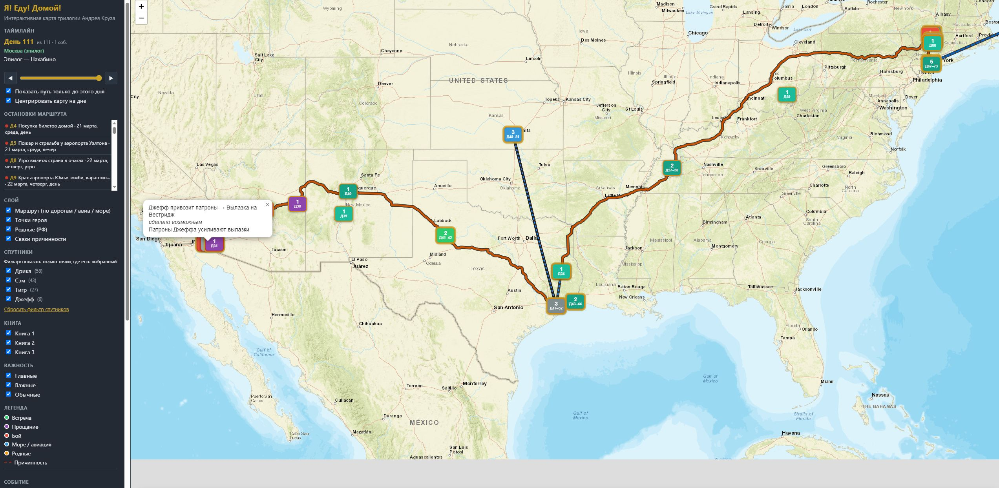
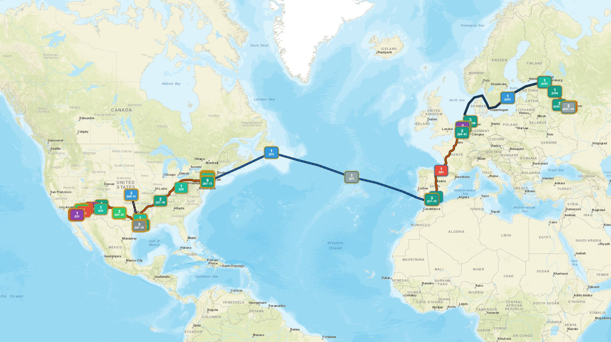

# IGH — «Я! Еду! Домой!» (карта маршрута)

Мемориальная интерактивная карта пути героя трилогии Андрея Круза из Америки в Россию.

## Скриншоты

Обзор США и панель фильтров:



Весь путь Америка → Атлантика → Европа → Россия:



Карточка хаба и список событий (Юма):


Карточка ключевого дня с причинностью (Ла-Порт):


## Быстрый старт

### Релиз (рекомендуется)

1. Распаковать zip **целиком** (рядом с `IGH.exe` должна быть папка `map/`).
2. Запустить `IGH.exe` (Windows) или `IGH.command` / `python3 igh_launcher.py` (macOS/Linux).
3. Браузер откроет карту; у `IGH.exe` нет консольного окна (подсистема windowed).
4. Чтобы выйти — кнопка **«Остановить сервер и выйти»** внизу левой панели (не нужно знать про `--quit`).

| Пакет | Подложка | Размер (ориентир) |
|-------|----------|-------------------|
| `IGH-<ver>-online.zip` | OSM онлайн (нужен интернет) | маленький |
| `IGH-<ver>-offline-medium.zip` | офлайн обзор до z6 вдоль маршрута | компактный |
| `IGH-<ver>-offline-full.zip` | офлайн до z14 только рядом с путём героя | больше |

Рядом с exe появляются:

| Файл | Зачем |
|------|--------|
| `igh.log` | лог сервера |
| `igh.state.json` | pid/port текущего фонового процесса |

Внизу левой панели — кнопка **«Остановить сервер и выйти»** (для большинства пользователей этого достаточно).

```text
IGH.exe              # старт в фоне + открыть карту (повторно — только снова открыть URL)
IGH.exe --quit       # остановить фоновый сервер (то же, что кнопка в браузере)
IGH.exe --foreground # отладка: держать процесс на переднем плане
```

### Сборка релизов

```text
python scripts/prepare_offline_assets.py --profile all   # кэш тайлов medium+full
python scripts/build_release.py                          # все три zip (+ exe)
# или: python scripts/build_release.py --variant offline-full
```

Артефакты: `dist/IGH-<ver>-*.zip`.

### Разработка без exe

```text
python scripts/build_map_data.py
python -m http.server 8765 --directory map
```

Открыть: http://127.0.0.1:8765/

## Возможности карты

- Маршрут героя по **дорогам** (OSRM) и **морю** (коридоры Атлантики и «Мариетты» вокруг Дании)
- Таймлайн **«День N»** + календарь книги («11 апреля, среда, утро»)
- Слои: герой / родные в РФ / причинность
- Фильтр **спутников**: Дрика, Сэм, Тигр, Джефф
- Карточка события: зачем / итог / кто / связи «из‑за этого → следствие»
- Список остановок; цвет обводки точки = книга

## Правила данных

- До **Кронштадта** (`book03-ch061`) главы про Москву / Подмосковье / «Пламя» — слой **родных (РФ)**, не маршрут героя.
- Ключевые спутники: **Сэм**, **Дрика** (Хендрике), **Тигр** (Викенбург), **Джефф**.
- Граф причинности: `data/extracted` (curated) + импорт рёбер из первичного пробного проекта I.Go.To.Home (`data/spine`).

## Структура

```text
data/extracted/   curated JSON книг 1–3, персонажи, coords_seed, causality
data/spine/       календарный скелет 164 глав, gazetteer, graph из I.Go.To.Home
data/raw/         полный текст по главам (gitignore)
map/              Leaflet UI + data.js
launchers/        igh_launcher.py (локальный HTTP + фон / --quit)
scripts/          сборка, импорт spine, парсинг FB2
docs/             merge-plan, screenshots/
VERSION           semver
```

| Файл / папка | Назначение |
|--------------|------------|
| `data/extracted/book0{1,2,3}_curated.json` | События, места, рёбра (истина сюжета) |
| `data/extracted/coords_seed.json` | Координаты точек |
| `data/spine/chapters.json` | Даты/время/локации глав |
| `launchers/igh_launcher.py` | Офлайн-сервер карты; в релизе упакован в `IGH.exe` |
| `scripts/build_map_data.py` | → `map/data.js`, `map/geo/*` |
| `scripts/build_release.py` | Три zip + exe (online / medium / full) |
| `scripts/import_spine_from_igth.py` | Обновить spine из локальной копии I.Go.To.Home |
| `docs/merge-plan.md` | Сравнение с I.Go.To.Home и план слияния |

## Сборка после правок данных

```text
python scripts/build_map_data.py
```

Обновить spine из локальной копии пробного проекта I.Go.To.Home:

```text
set IGTH_ROOT=path\to\I.Go.To.Home
python scripts/import_spine_from_igth.py
python scripts/build_map_data.py
```

## Стек

| Роль | Выбор |
|------|--------|
| Карта | Leaflet; офлайн-контур суши (OSM опционально `?tiles=osm`) |
| Сухопутный маршрут | OSRM (кэш `data/extracted/osrm_route_cache.json`) |
| Море / авиа | коридоры + дуги |
| Данные | curated JSON + spine |

## Приватность

| Режим | Сеть |
|-------|------|
| `offline-medium` / `offline-full` / `IGH.exe` без `?tiles=osm` | Локальные тайлы; наружу ничего не уходит |
| `online` или `?tiles=osm` / `#osm` | Запросы тайлов на `*.tile.openstreetmap.org` (IP, область карты, zoom, User-Agent) |

Аналитики, телеметрии и POST «домой» в проекте нет. Сборка офлайн-кэша (`prepare_offline_assets.py`) ходит на ArcGIS / unpkg только на машине разработчика.

## Версия

См. файл `VERSION`.
